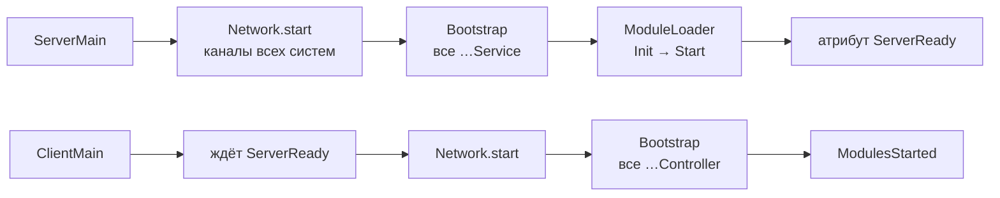
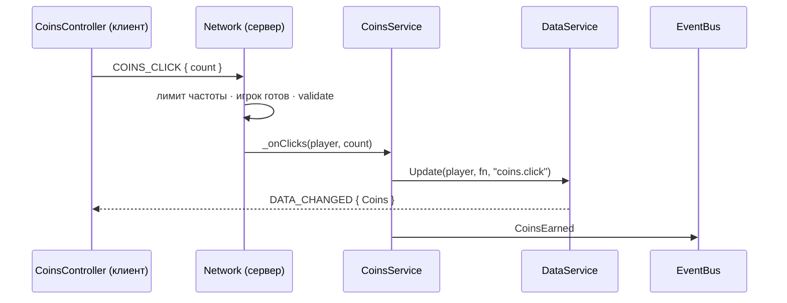

# Архитектура

## Запуск

- Синглтон объявляет `name` и `dependencies`. `DependencyGraph` сортирует их, `ModuleLoader` запускает фазами.
- Ошибка в `require`, `Init` или `Start` не роняет игру: модуль становится `FAILED`, все, кто от него зависит, — `SKIPPED`. В логе — одна первопричина и время каждого модуля.
- Чужой сервис берётся только через `Registry:get` с именем из `dependencies`. Через `require` подключаются только Config / Channels / Events / Types и чистая логика.

## Путь одного запроса (пример Coins)

1. Клиент только просит: присылает, сколько раз кликнул. Сколько это монет, решает сервер.
2. Канал объявлен с `rate`, обработчик — с `validate`. Запрос не прошёл — отказ с кодом, обработчик не вызывается.
3. Поле `Coins` в профиле принадлежит только `CoinsService`. Запись — одна правка через `DataService:Update`: профиль меняется в памяти сервера, клиент получает изменённые ключи.
4. Остальные системы узнают о начислении из `CoinsEarned` на шине. `CoinsService` о них не знает.

## Сохранения

- ProfileStore держит профиль в памяти сервера всю сессию и сохраняет его автосохранением и при выходе. Запись в DataStore на каждое действие упёрлась бы в лимиты.
- Покупка за Robux — исключение: `SaveAndWait` до ответа Roblox «выдано», чтобы оплаченное не пропало при падении сервера.
- Схема профиля — `DataConfig.Default`. Новое поле доливается старым игрокам само; смена смысла поля — новая версия и шаг в `DataMigrations` (чистая функция, проверяется тестом).
- `DataConfig.Private` — поля, которые не уходят клиенту.

## Правила

1. В начале файла `--!strict` и шапка «Что / Почему так / Не здесь».
2. Синглтон: `X = Lifecycle:extend()`. В `Init` — только ссылки и сброс состояния, в `Start` — работа. Подписки и потоки — через `_bind`, `_spawn`, `_delay`.
3. Сеть — только через `<S>Channels`. Сервер слушает только с `validate`.
4. Любое число, текст или тайминг — в `<S>Config`.
5. У каждого поля профиля и атрибута один писатель.
6. Вместо `print` и `warn` — `Logger`.
7. Модуль отвечает за одно: 300 строк — повод делить.
